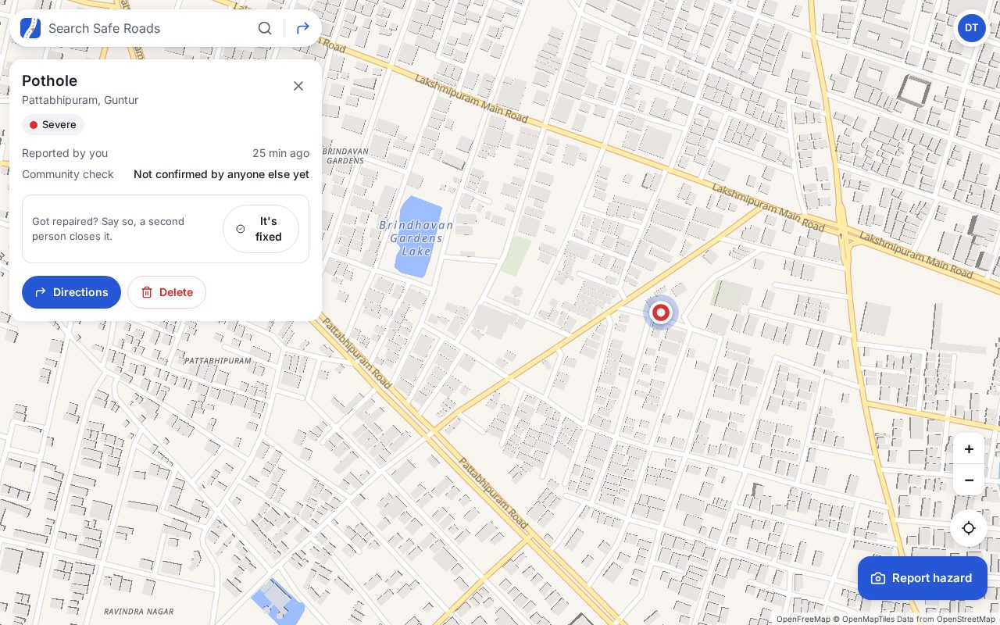
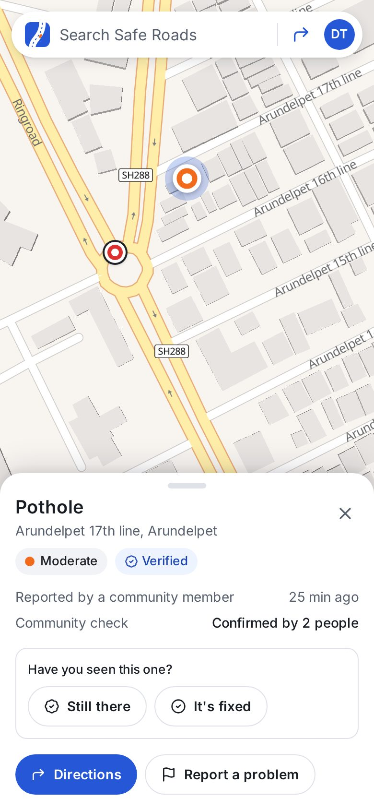
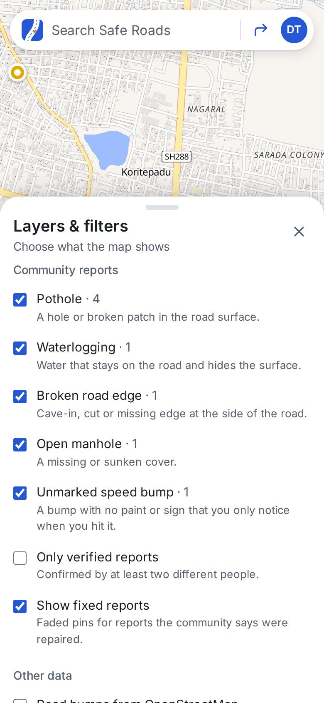
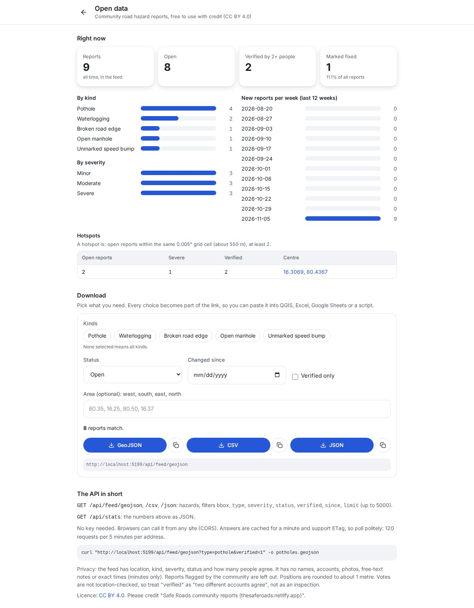

# Safe Roads

A community map of road hazards (potholes, waterlogging, broken road edges, open manholes, unmarked speed bumps). Open it, see what people reported around you, tap **Report hazard** to add one with a photo, confirm or close other people's reports, and check what is on your route before you drive. Councils, researchers and apps can download the same data as GeoJSON or CSV, free.

**Live:** https://thesaferoads.netlify.app &nbsp;·&nbsp; **Code:** https://github.com/Tejdeep-67/safe-roads

<p>
  
  
</p>

<sub>The screenshots in this README come from a local dev server (`npm run dev:api`) with a handful of test reports I typed in myself, so there is something to look at. The live site has no sample or made-up reports.</sub>

Version 4 (this one) turns it from "a map I report on" into something a city could use: the community checks reports instead of one person deciding, there is a moderator queue and an open data feed, and the made-up sample pins are gone.

This started as a semester project where a Flask server ran a YOLOv8 model on uploaded photos. Version 2 moved the detection into the browser. For version 3 I redesigned the whole thing because it had too many pages and buttons: now it is one screen that works like Google Maps, with real accounts so every report belongs to someone.

## Using it

- **The map is the home screen.** Pins are coloured by how bad the hazard is (yellow minor, orange moderate, red severe) and group into bubbles when you zoom out. A dark ring around a pin means at least two people confirmed it. Faded pins are reports the community says were fixed (hidden unless you turn them on). Tap a pin to see its photo, how many people confirmed it and how far it is from you.
- **Search** at the top finds places as you type. The ↱ button next to it opens **directions**.
- **Report hazard** (bottom right): take a photo or pick one, say what it is (pothole, waterlogging, broken road edge, open manhole, unmarked speed bump) and how bad. For potholes the model looks at the photo on your phone and draws boxes; the severity is a guess from the size and you can change it. The location comes from the photo's GPS, or your phone's GPS, or you place the pin on the map yourself. You can also report without a photo.
- **Community check.** On someone else's report you can say **Still there** or **It's fixed**, or **Report a problem** (not real, wrong place, spam, offensive). The reporter counts as the first confirmation; a second person makes it *verified*. Two people saying *fixed* (and more of them than people saying *still there*) mark it fixed. Three different people flagging a report hide it until a moderator has looked. You can't vote on your own report.
- **Layers & filters** (account menu): choose which kinds to show, only verified reports, show fixed ones, and an optional **Road bumps from OpenStreetMap** layer. That layer is real third-party data (speed bumps, humps and tables that mapmakers recorded in OpenStreetMap, ODbL), shown as grey squares so nobody confuses it with community reports. Coverage in OpenStreetMap varies a lot by area.
- **Directions**: from your location (or any place) to where you're going. It shows up to 3 routes from OSRM, how many open reports are within 30 m of each, and the list in the order you'll reach them. **Start** follows your GPS and warns you by voice and vibration 150 m before each one. **Demo drive** drives along the route by itself, for trying it at a desk.
- **Data for authorities** (account menu, or `/data`): live numbers (reports, verified, fixed, per kind and severity, per week, hotspots) and a download builder for GeoJSON, CSV and JSON. See [docs/API.md](docs/API.md).
- **Moderation** (`/moderate`, only for accounts listed in `MODERATOR_EMAILS`): the queue of flagged reports with approve, remove, mark fixed and reopen.
- **Account menu** (top right): sign in / create account, My reports (with delete), the detection demo, dark map, layers, about.

Looking at the map needs no account. Reporting and voting do, so that only the person who reported something can delete it and one person can't vote twice.

<p>
  
  
</p>

## Android app

**Download:** [safe-roads.apk](https://github.com/Tejdeep-67/safe-roads/releases/latest/download/safe-roads.apk) (3.6 MB, Android 7+) · [release page](https://github.com/Tejdeep-67/safe-roads/releases/latest)

It isn't on the Play Store, so Android asks you to allow installing from your browser or Files app the first time. Allow it once and tap Install. On an iPhone or a laptop you don't need anything: open the site and use *Add to Home Screen* (Safari) or the install icon in Chrome/Edge's address bar, it's a PWA with a service worker.

How the app is built: it's a [Capacitor](https://capacitorjs.com) app (`android/`, `capacitor.config.json`) whose WebView opens the live site, `https://thesaferoads.netlify.app`, instead of a copy of the build packed inside the APK. I went this way on purpose:

- **Login keeps working.** The session is an httpOnly, `SameSite=Lax` cookie for `thesaferoads.netlify.app`. If the app served its own copy of the site from `https://localhost`, every API call would be cross-site, the cookie wouldn't be sent, and I'd have to loosen the cookie to `SameSite=None` and add CORS, which makes CSRF harder to rule out. Loading the real site keeps everything same-origin.
- **One codebase, updates without a new APK.** A Netlify deploy updates the app too. The APK only changes if the Android side changes.
- **Camera and GPS work like in Chrome.** Capacitor's WebView handles `<input capture>` (opens the camera app), `getUserMedia` (live camera on the detection page) and geolocation, and asks for the Android permission the first time. The manifest declares `CAMERA`, `ACCESS_FINE_LOCATION`/`ACCESS_COARSE_LOCATION` and `VIBRATE` (drive mode).
- **No internet** shows a small offline screen from the APK (`app-shell/offline.html`) that reloads by itself when you're back online. The service worker is only used in browsers, not inside the app.

The downside is that the app needs a connection to start, but so does the map, search and reporting anyway.

Building the APK yourself (JDK 21 and the Android SDK, `compileSdk 36`):

```bash
npm ci
npx cap sync android
cd android && ./gradlew assembleRelease     # android/app/build/outputs/apk/release/app-release.apk
```

Release signing reads a `keystore.properties` (`storeFile`, `storePassword`, `keyAlias`, `keyPassword`) from `android/` or from the path in `SIGNING_PROPS`. The keystore itself is not in the repo. Icons and splash screens are generated from `assets/` with `npx @capacitor/assets generate --android`.

## How sign-in works (and why it's built this way)

I didn't want a fake login or a paid auth service, and I wanted it to run on Netlify's free plan with nothing else to sign up for. So accounts are three small Netlify Functions with Netlify Blobs as the database.

- **Passwords** are hashed with **scrypt** (`node:crypto`, N=16384, r=8, p=1) and a random 16-byte salt per user, and checked with `timingSafeEqual`. The stored string looks like `scrypt$16384$8$1$<salt>$<hash>`, so the cost can be raised later without breaking old accounts. The plain password is never stored or logged.
- **Sessions** are a signed token, `base64url(payload).HMAC-SHA256(payload, SESSION_SECRET)`, with the user id and an expiry (30 days). It lives in an **httpOnly, Secure, SameSite=Lax cookie**, so JavaScript on the page can't read it (an XSS bug can't steal it) and other sites can't send it with a POST. If `SESSION_SECRET` is missing the functions refuse to sign anyone in instead of using a default.
- **CSRF**: besides SameSite, every POST/DELETE must come from the site's own origin (the `Origin` header is checked).
- **Rate limits** for sign-in (30 per 15 min per IP, since a whole hostel can share one IP, plus 10 per 15 min per account), sign-up (10 per hour per IP) and reports (12 per 10 min per user). The counters are tiny blobs keyed by a hash of the IP, so raw IPs are never stored.
- **Errors don't leak accounts**: a wrong password and an unknown email give the same message, and an unknown email still runs a full scrypt check so the timing matches. (Sign-up has to say when an email is taken; without email verification there's no way around that, and it's rate limited.)
- **Ownership** is checked on the server: a report stores its owner's id, and `DELETE /api/hazards/:id` only works for that owner. Other people only ever see your first name.
- Deleting your account (in My reports) needs your password and also deletes all your reports and photos.

### API

| Endpoint | What it does |
|---|---|
| `POST /api/auth/signup` | `{name, email, password}` → creates the account, sets the cookie |
| `POST /api/auth/login` | `{email, password}` → sets the cookie |
| `POST /api/auth/logout` | clears the cookie |
| `GET /api/auth/me` | the signed-in user, or `null` |
| `DELETE /api/auth/me` | `{password}` → deletes the account and its reports |
| `GET /api/hazards` | visible reports (anyone) · `?bbox=minLng,minLat,maxLng,maxLat` · `?mine=1` only mine · `?stale=1` also old unconfirmed ones |
| `POST /api/hazards` | new report (signed in): `{lat, lng, type?, severity, confidence?, potholes?, source, note?, photo?}` |
| `DELETE /api/hazards/:id` | delete my own report |
| `POST /api/hazards/:id/vote` · `DELETE …/vote` | `{vote: confirm \| fixed \| flag, reason?}` · take it back |
| `GET /api/photos/:id` | the photo of a report |
| `GET /api/feed/geojson` · `/csv` · `/json` | open data feed with filters, CORS, ETag, rate limited (see [docs/API.md](docs/API.md)) |
| `GET /api/stats` | counts, weekly trend, hotspots |
| `GET/POST /api/moderation[/:id]` | moderators only |
| `GET /api/health` | is the API up, can it reach Blobs, is sign-in configured |

### What's stored in Netlify Blobs

```
safe-roads-users     users/<id>            {id, name, email, passwordHash, createdAt}
                     emails/<sha256(email)> {userId}          (written with onlyIfNew = unique emails)
safe-roads-hazards   t/<latIdx>_<lngIdx>   [ {id, lat, lng, type, severity, confidence, potholes, source, note,
                                              createdAt, updatedAt, ownerId, hasPhoto, status,
                                              votes: {confirm: [userId], fixed: [userId], flag: [{u, r}]}}, ... ]
safe-roads-photos    <reportId>            the JPEG (metadata stripped)
safe-roads-limits    rl/<bucket>/<hash>    {start, count}
```

Reports live in **map tiles**: one blob per 0.1° square (about 11 km, roughly one city), with at most 1500 reports each. A report id is `<latIdx>_<lngIdx>.<uuid>`, so any id tells the server which tile to open. That keeps each write small, lets the feed read only the tiles a bounding box touches, and means two people reporting in different cities never fight over the same etag. Reports from version 3 (one big `reports` blob) are moved into tiles, photos included, on the first read; the live site had none when I checked.

All stores use strong consistency, so a report is visible to the next request right away. A tile is updated with the etag (`onlyIfMatch`) and retried if two people save at the same moment. Votes are stored as user ids inside the report on the server; the public API only shows counts. Photos are shrunk in the browser first (max 1024 px, JPEG ~0.7, under 350 KB), and the server strips EXIF (the phone's GPS position, camera model, time), XMP and comments from every photo before storing it.

## How the detection works

1. The photo (or video frame) is sent to a Web Worker as an `ImageBitmap`.
2. The worker letterboxes it and runs `pothole-yolov8n-seg.onnx` with ONNX Runtime Web: WebGPU when the browser has it, otherwise multi-threaded WASM (threads need cross-origin isolation, which is why `netlify.toml` sets COOP/COEP headers).
3. Boxes above the threshold go through NMS, and each box's 32 mask coefficients are combined with the prototype masks to get the outline.
4. Severity is a rule of thumb: how much of the frame the pothole covers, corrected for how low in the frame it is (closer things look bigger). It is not a depth measurement.
5. In videos a small IoU tracker counts each pothole once, after it shows up in 3 frames.

The detection demo page (menu → Detection demo) runs it on demo photos, a demo video, your camera or your own file, with the count and FPS.


## Model and results

The weights are a YOLOv8n-seg model (3.26M parameters, one class) fine-tuned on the Kaggle *Pothole Image Segmentation* dataset. I didn't train it myself. I exported it to ONNX (14 MB) and checked it against the PyTorch model: the biggest difference in the raw output was 0.003 and the final boxes were identical on every test image (`model/check_onnx.py`).

The validation mAP saved inside the checkpoint (0.68) is from the training run on its own validation split, so I don't quote it. I tested it myself on a **different public dataset**, the 100-image test split of Roboflow's "Potholes Detection" set (269 potholes), with the same letterbox + NMS as the web app:

| Input size | mAP@50 | mAP@50-95 | Precision @0.35 | Recall @0.35 |
|---|---|---|---|---|
| 640 | 0.341 | 0.158 | 0.676 | 0.279 |
| 416 | 0.363 | 0.172 | 0.717 | 0.264 |
| 320 | 0.340 | 0.156 | 0.724 | 0.234 |

So when it says "pothole" it's right about 2 times out of 3, but it misses a lot, especially small or far-away ones (recall 0.19 for small vs 0.41 for large). That's why reporting never depends on the model. Ultralytics' own `val` gives 0.333 mAP@50 on the same split for both the `.pt` and the `.onnx`, which matches my script. Details in [`model/README.md`](model/README.md).

## Run it locally

You need Node 20+ and the Netlify CLI for the API.

```bash
npm ci
cp .env.example .env          # put a random string in SESSION_SECRET
npx netlify dev               # app + functions + a local Blobs store on http://localhost:8888
npm test                      # vitest (detection + route maths) and node tests (auth, reports)
npm run build                 # type-check + production build into dist/
```

`npm run dev` also works, but then there's no API and the map says the server can't be reached. For a quick local run without the Netlify CLI, start `npm run dev:api` in one terminal (the same handlers with in-memory stores, empty on start; the moderator account is `mod@example.com`) and `npm run dev` in another: Vite proxies `/api` to it.

### Flask backend (optional)

Runs the original PyTorch weights (`backend/models/best.pt`) for detection from scripts or a server. The web app doesn't use it (accounts and reports are the Netlify Functions). Python 3.10+.

```bash
cd backend
python -m venv .venv && source .venv/bin/activate
pip install torch==2.15.0 torchvision==0.29.2 --index-url https://download.pytorch.org/whl/cpu
pip install -r requirements.txt
python app.py      # http://127.0.0.1:5000
pytest
curl -F image=@../public/demo/pothole-2.jpg http://127.0.0.1:5000/api/detect
```

### Model scripts

```bash
cd model
pip install -r requirements.txt
python export_onnx.py                         # best.pt -> public/models/pothole-yolov8n-seg.onnx
python check_onnx.py ../public/demo/*.jpg     # ONNX vs PyTorch
python get_test_data.py && python evaluate.py --model ../public/models/pothole-yolov8n-seg.onnx --data eval_ds --split test
```

## Deploying on Netlify

`netlify.toml` has everything: build `npm run build`, publish `dist`, functions in `netlify/functions`. Netlify Blobs needs no setup. Environment variables (Site configuration → Environment variables): **`SESSION_SECRET`** (a long random string; without it the map works but sign-in is switched off) and **`MODERATOR_EMAILS`** (comma-separated emails of the accounts that may use `/moderate`; leave it out and nobody is a moderator).

## Project structure

```
src/
  map/         MapApp (the one screen), Leaflet setup, pins + clustering
  ui/          search bar, panels (bottom sheet / side panel), report flow, directions, drive mode, account menu
  auth/        AuthProvider (talks to /api/auth)
  hazards/     shared store client, hazard kinds, map filters, trust text
  detection/   worker, ONNX session, post-processing (decode, NMS, masks), tracker, drawing
  geo/         haversine, point-to-route distance, search + routing calls, drive mode, my location
  pages/       DetectDemo, DataPage (/data), ModeratePage (/moderate)
  lib/         api wrapper, OpenStreetMap (Overpass) road features, feed URL builder
netlify/functions/   auth, hazards, photos, feed, stats, moderation, health + lib/ (the logic, tested in netlify/tests)
dev/           api-server.mjs: in-memory stand-in for the functions, for local runs and screenshots
backend/       optional Flask API with the PyTorch model, pytest
model/         ONNX export, ONNX check, evaluation scripts and results
public/        ONNX model, demo photos and video, icons, service worker (sw.js)
android/       Capacitor Android project (the APK)
app-shell/     what the APK ships itself: the offline screen
assets/        source images for the app icon and splash
```

## Limitations

- The model misses many potholes (recall ~0.28), especially small or far ones, and is worse at night or in rain.
- Severity is a size guess, not depth.
- Phone GPS is off by 5-15 m, so pins are approximate.
- No email verification or password reset yet (that needs an email service).
- Votes are not location-checked: "verified" means two different accounts agree, not that someone stood at the spot. One person with several accounts could still fake agreement; the rate limits and the stricter limits for new accounts slow that down, they don't stop it. Moderators are the backstop.
- Moderation depends on at least one moderator existing (`MODERATOR_EMAILS`) and looking at the queue.
- There is no way to know how much of a city is covered: no reports in an area means nobody reported there.
- The OpenStreetMap bumps layer depends on the public Overpass server (it can be slow or busy; the app gives up after 25 s and says so) and on how well your area is mapped.
- A hazard's type and severity are the reporter's word. The detection model only helps for potholes.
- Sign-out clears the cookie; a stolen token would stay valid until it expires, since tokens aren't stored on the server.
- The rate-limit counters aren't atomic, so two requests at the exact same moment can both get through. Fine for slowing down spam and password guessing, not a hard quota.
- OpenFreeMap, Photon, Nominatim, OSRM and the OSM tile servers are free public services with fair-use limits.
- Old phones without WebGPU run the model at a few frames per second.
- The Android app is a sideloaded APK, so Play Protect may show a warning the first time (it doesn't know the developer). It also needs internet to open.

Next I'd like to add password reset by email, alerts only for verified reports, and offline caching of a route's hazards.

## Credits

- Demo photos from Wikimedia Commons: [BACHES 1](https://commons.wikimedia.org/wiki/File:BACHES_1.jpg) by Raammm10431 (CC BY-SA 4.0), [Bache mediano](https://commons.wikimedia.org/wiki/File:Bache_mediano.jpg) by Dan crxs (CC BY 4.0), [Otro bache](https://commons.wikimedia.org/wiki/File:Otro_bache.jpg) (CC0).
- Demo video: [Rainwater-Filled Potholes on a Community Road](https://commons.wikimedia.org/wiki/File:Rainwater-Filled_Potholes_on_a_Community_Road.webm) by Knowledge and philosophy (CC BY-SA 4.0), trimmed.
- Test data: [Potholes Detection](https://universe.roboflow.com/project-ssayl/potholes-detection-d4rma) (Roboflow Universe, CC BY 4.0).
- Training data of the model: [Pothole Image Segmentation Dataset](https://www.kaggle.com/datasets/farzadnekouei/pothole-image-segmentation-dataset) (Kaggle).
- Road bump layer: speed bumps, humps and tables from OpenStreetMap via the Overpass API, © OpenStreetMap contributors (ODbL).
- Map data © OpenStreetMap contributors. Base map by [OpenFreeMap](https://openfreemap.org) (OpenMapTiles schema, drawn with MapLibre; plain OSM tiles as a fallback). Place search by Photon (komoot) and Nominatim, routing by OSRM.
- Built with React, TypeScript, Vite, Tailwind CSS, Leaflet, MapLibre, ONNX Runtime Web and Ultralytics YOLOv8. Android app with Capacitor.

## License

My code is under the [MIT License](LICENSE). The things I didn't make keep their own licences: the model weights come from Ultralytics YOLOv8, which is AGPL-3.0, and from a dataset with its own terms; the demo photos, demo video and test data are under the CC licences listed in Credits; map data is © OpenStreetMap contributors (ODbL). The community reports in the open data feed are offered under CC BY 4.0, see [docs/API.md](docs/API.md).
