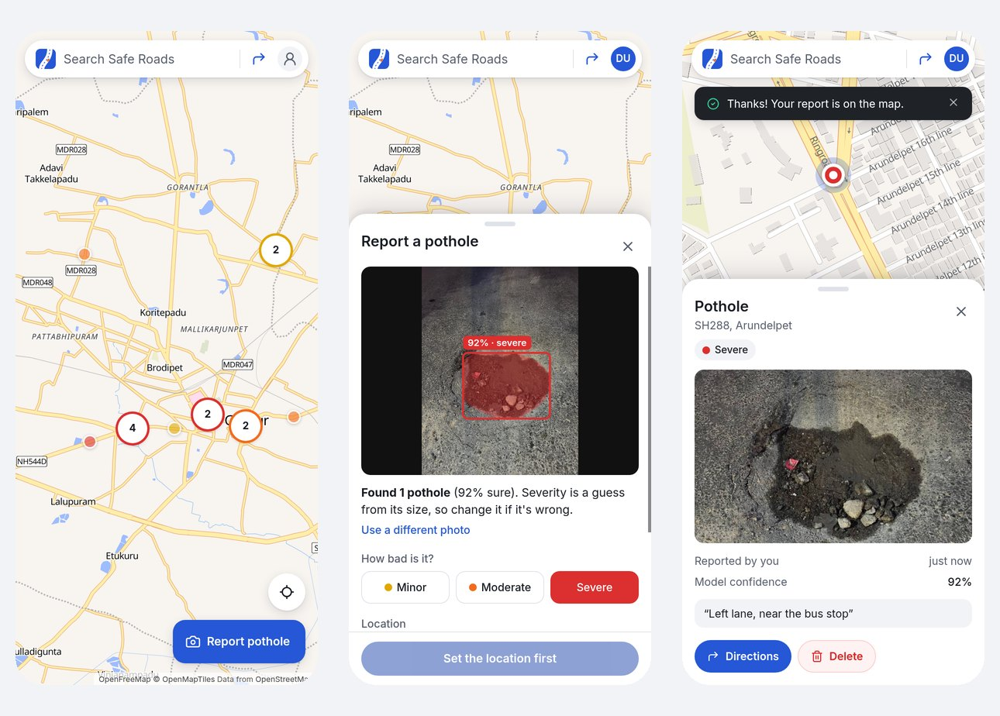
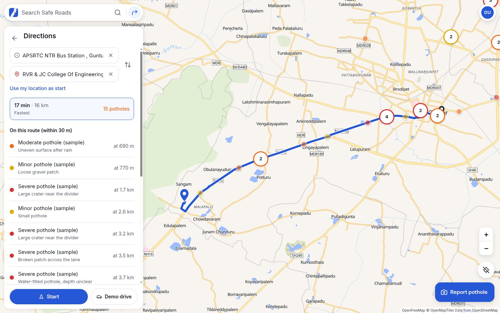
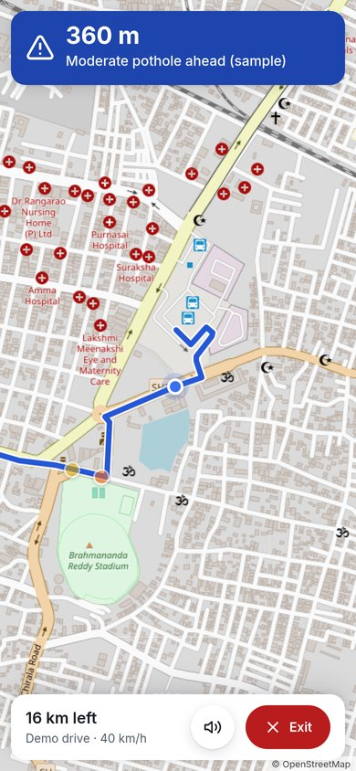
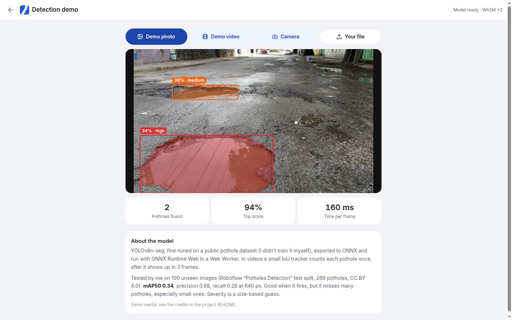

# Safe Roads

A simple map of potholes. Open it, see the potholes around you, tap **Report pothole** to add one with a photo, and check the potholes on your route before you drive.

**Live:** https://thesaferoads.netlify.app &nbsp;·&nbsp; **Code:** https://github.com/Tejdeep-67/safe-roads



This started as a semester project where a Flask server ran a YOLOv8 model on uploaded photos. Version 2 moved the detection into the browser. For version 3 I redesigned the whole thing because it had too many pages and buttons: now it is one screen that works like Google Maps, with real accounts so every report belongs to someone.

## Using it

- **The map is the home screen.** Pins are coloured by how bad the pothole is (yellow minor, orange moderate, red severe) and group into bubbles when you zoom out. Tap a pin to see its photo, who reported it and when, and how far it is from you.
- **Search** at the top finds places as you type. The ↱ button next to it opens **directions**.
- **Report pothole** (bottom right): take a photo or pick one. The model looks for potholes on your phone and draws boxes around them, and picks a severity from the size (you can change it). The location comes from the photo's GPS, or your phone's GPS, or you place the pin on the map yourself. If the model finds nothing you can still report it, and you can also report without a photo.
- **Directions**: from your location (or any place) to where you're going. It shows up to 3 routes from OSRM, how many potholes are within 30 m of each, and the list in the order you'll reach them. **Start** follows your GPS and warns you by voice and vibration 150 m before each pothole. **Demo drive** drives along the route by itself, for trying it at a desk.
- **Account menu** (top right): sign in / create account, My reports (with delete), the detection demo, dark map, hide sample pins, about.

Looking at the map needs no account. Reporting does, so that only the person who reported something can delete it.

<p>
  
  
</p>

The faded pins around Guntur and Vijayawada are **sample data** I placed on real roads so the map isn't empty on the first visit. They say "sample" when you open them and can be hidden from the menu.

## How sign-in works (and why it's built this way)

I didn't want a fake login or a paid auth service, and I wanted it to run on Netlify's free plan with nothing else to sign up for. So accounts are three small Netlify Functions with Netlify Blobs as the database.

- **Passwords** are hashed with **scrypt** (`node:crypto`, N=16384, r=8, p=1) and a random 16-byte salt per user, and checked with `timingSafeEqual`. The stored string looks like `scrypt$16384$8$1$<salt>$<hash>`, so the cost can be raised later without breaking old accounts. The plain password is never stored or logged.
- **Sessions** are a signed token, `base64url(payload).HMAC-SHA256(payload, SESSION_SECRET)`, with the user id and an expiry (30 days). It lives in an **httpOnly, Secure, SameSite=Lax cookie**, so JavaScript on the page can't read it (an XSS bug can't steal it) and other sites can't send it with a POST. If `SESSION_SECRET` is missing the functions refuse to sign anyone in instead of using a default.
- **CSRF**: besides SameSite, every POST/DELETE must come from the site's own origin (the `Origin` header is checked).
- **Rate limits** for sign-in (30 per 15 min per IP, since a whole hostel can share one IP, plus 10 per 15 min per account), sign-up (10 per hour per IP) and reports (12 per 10 min per user). The counters are tiny blobs keyed by a hash of the IP, so raw IPs are never stored.
- **Errors don't leak accounts**: a wrong password and an unknown email give the same message, and an unknown email still runs a full scrypt check so the timing matches. (Sign-up has to say when an email is taken; without email verification there's no way around that, and it's rate limited.)
- **Ownership** is checked on the server: a report stores its owner's id, and `DELETE /api/hazards/:id` only works for that owner. Other people only ever see your first name.
- Deleting your account (in My reports) needs your password and also deletes all your reports and photos.

### API

| Endpoint | What it does |
|---|---|
| `POST /api/auth/signup` | `{name, email, password}` → creates the account, sets the cookie |
| `POST /api/auth/login` | `{email, password}` → sets the cookie |
| `POST /api/auth/logout` | clears the cookie |
| `GET /api/auth/me` | the signed-in user, or `null` |
| `DELETE /api/auth/me` | `{password}` → deletes the account and its reports |
| `GET /api/hazards` | all reports (anyone) · `?mine=1` only mine |
| `POST /api/hazards` | new report (signed in): `{lat, lng, severity, confidence?, potholes?, source, note?, photo?}` |
| `DELETE /api/hazards/:id` | delete my own report |
| `GET /api/photos/:id` | the photo of a report |
| `GET /api/health` | is the API up, can it reach Blobs, is sign-in configured |

### What's stored in Netlify Blobs

```
safe-roads-users     users/<id>            {id, name, email, passwordHash, createdAt}
                     emails/<sha256(email)> {userId}          (written with onlyIfNew = unique emails)
safe-roads-hazards   reports               [ {id, lat, lng, severity, confidence, potholes, source,
                                              note, createdAt, ownerId, ownerName, hasPhoto}, ... ]
safe-roads-photos    <reportId>            the JPEG
safe-roads-limits    rl/<bucket>/<hash>    {start, count}
```

All stores use strong consistency, so a report is visible to the next request right away. The reports list is updated with the etag (`onlyIfMatch`) and retried if two people save at the same moment. Photos are shrunk in the browser first (max 1024 px, JPEG ~0.7, under 350 KB).

## How the detection works

1. The photo (or video frame) is sent to a Web Worker as an `ImageBitmap`.
2. The worker letterboxes it and runs `pothole-yolov8n-seg.onnx` with ONNX Runtime Web: WebGPU when the browser has it, otherwise multi-threaded WASM (threads need cross-origin isolation, which is why `netlify.toml` sets COOP/COEP headers).
3. Boxes above the threshold go through NMS, and each box's 32 mask coefficients are combined with the prototype masks to get the outline.
4. Severity is a rule of thumb: how much of the frame the pothole covers, corrected for how low in the frame it is (closer things look bigger). It is not a depth measurement.
5. In videos a small IoU tracker counts each pothole once, after it shows up in 3 frames.

The detection demo page (menu → Detection demo) runs it on demo photos, a demo video, your camera or your own file, with the count and FPS.



## Model and results

The weights are a YOLOv8n-seg model (3.26M parameters, one class) fine-tuned on the Kaggle *Pothole Image Segmentation* dataset. I didn't train it myself. I exported it to ONNX (14 MB) and checked it against the PyTorch model: the biggest difference in the raw output was 0.003 and the final boxes were identical on every test image (`model/check_onnx.py`).

The validation mAP saved inside the checkpoint (0.68) is from the training run on its own validation split, so I don't quote it. I tested it myself on a **different public dataset**, the 100-image test split of Roboflow's "Potholes Detection" set (269 potholes), with the same letterbox + NMS as the web app:

| Input size | mAP@50 | mAP@50-95 | Precision @0.35 | Recall @0.35 |
|---|---|---|---|---|
| 640 | 0.341 | 0.158 | 0.676 | 0.279 |
| 416 | 0.363 | 0.172 | 0.717 | 0.264 |
| 320 | 0.340 | 0.156 | 0.724 | 0.234 |

So when it says "pothole" it's right about 2 times out of 3, but it misses a lot, especially small or far-away ones (recall 0.19 for small vs 0.41 for large). That's why reporting never depends on the model. Ultralytics' own `val` gives 0.333 mAP@50 on the same split for both the `.pt` and the `.onnx`, which matches my script. Details in [`model/README.md`](model/README.md).

## Run it locally

You need Node 20+ and the Netlify CLI for the API.

```bash
npm ci
cp .env.example .env          # put a random string in SESSION_SECRET
npx netlify dev               # app + functions + a local Blobs store on http://localhost:8888
npm test                      # vitest (detection + route maths) and node tests (auth, reports)
npm run build                 # type-check + production build into dist/
```

`npm run dev` also works, but then there's no API: the map shows the sample pins and says the server can't be reached, and sign-in/reporting are paused.

### Flask backend (optional)

Runs the original PyTorch weights (`backend/models/best.pt`) for detection from scripts or a server. The web app doesn't use it (accounts and reports are the Netlify Functions). Python 3.10+.

```bash
cd backend
python -m venv .venv && source .venv/bin/activate
pip install torch==2.15.0 torchvision==0.29.2 --index-url https://download.pytorch.org/whl/cpu
pip install -r requirements.txt
python app.py      # http://127.0.0.1:5000
pytest
curl -F image=@../public/demo/pothole-2.jpg http://127.0.0.1:5000/api/detect
```

### Model scripts

```bash
cd model
pip install -r requirements.txt
python export_onnx.py                         # best.pt -> public/models/pothole-yolov8n-seg.onnx
python check_onnx.py ../public/demo/*.jpg     # ONNX vs PyTorch
python get_test_data.py && python evaluate.py --model ../public/models/pothole-yolov8n-seg.onnx --data eval_ds --split test
```

## Deploying on Netlify

`netlify.toml` has everything: build `npm run build`, publish `dist`, functions in `netlify/functions`. Netlify Blobs needs no setup. The one thing to add is an environment variable **`SESSION_SECRET`** (a long random string) under Site configuration → Environment variables; without it the map works but sign-in is switched off.

## Project structure

```
src/
  map/         MapApp (the one screen), Leaflet setup, pins + clustering
  ui/          search bar, panels (bottom sheet / side panel), report flow, directions, drive mode, account menu
  auth/        AuthProvider (talks to /api/auth)
  hazards/     shared store client, sample data
  detection/   worker, ONNX session, post-processing (decode, NMS, masks), tracker, drawing
  geo/         haversine, point-to-route distance, search + routing calls, drive mode, my location
  pages/       DetectDemo
netlify/functions/   auth, hazards, photos, health + lib/ (the logic, tested in netlify/tests)
backend/       optional Flask API with the PyTorch model, pytest
model/         ONNX export, ONNX check, evaluation scripts and results
public/        ONNX model, demo photos and video, icons
```

## Limitations

- The model misses many potholes (recall ~0.28), especially small or far ones, and is worse at night or in rain.
- Severity is a size guess, not depth.
- Phone GPS is off by 5-15 m, so pins are approximate.
- No email verification or password reset yet (that needs an email service). No moderation of reports either.
- Sign-out clears the cookie; a stolen token would stay valid until it expires, since tokens aren't stored on the server.
- The rate-limit counters aren't atomic, so two requests at the exact same moment can both get through. Fine for slowing down spam and password guessing, not a hard quota.
- OpenFreeMap, Photon, Nominatim, OSRM and the OSM tile servers are free public services with fair-use limits.
- Old phones without WebGPU run the model at a few frames per second.

Next I'd like to add password reset by email, a "confirmed by N people" filter for alerts, and offline caching of a route's potholes. I'm also planning an Android app version.

## Credits

- Demo photos from Wikimedia Commons: [BACHES 1](https://commons.wikimedia.org/wiki/File:BACHES_1.jpg) by Raammm10431 (CC BY-SA 4.0), [Bache mediano](https://commons.wikimedia.org/wiki/File:Bache_mediano.jpg) by Dan crxs (CC BY 4.0), [Otro bache](https://commons.wikimedia.org/wiki/File:Otro_bache.jpg) (CC0).
- Demo video: [Rainwater-Filled Potholes on a Community Road](https://commons.wikimedia.org/wiki/File:Rainwater-Filled_Potholes_on_a_Community_Road.webm) by Knowledge and philosophy (CC BY-SA 4.0), trimmed.
- Test data: [Potholes Detection](https://universe.roboflow.com/project-ssayl/potholes-detection-d4rma) (Roboflow Universe, CC BY 4.0).
- Training data of the model: [Pothole Image Segmentation Dataset](https://www.kaggle.com/datasets/farzadnekouei/pothole-image-segmentation-dataset) (Kaggle).
- Map data © OpenStreetMap contributors. Base map by [OpenFreeMap](https://openfreemap.org) (OpenMapTiles schema, drawn with MapLibre; plain OSM tiles as a fallback). Place search by Photon (komoot) and Nominatim, routing by OSRM.
- Built with React, TypeScript, Vite, Tailwind CSS, Leaflet, MapLibre, ONNX Runtime Web and Ultralytics YOLOv8.
