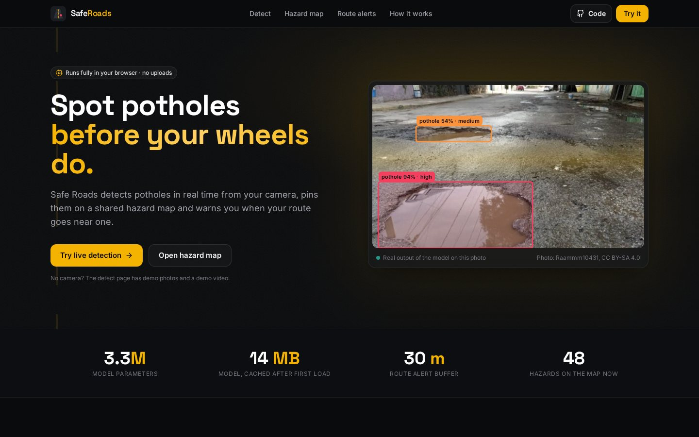
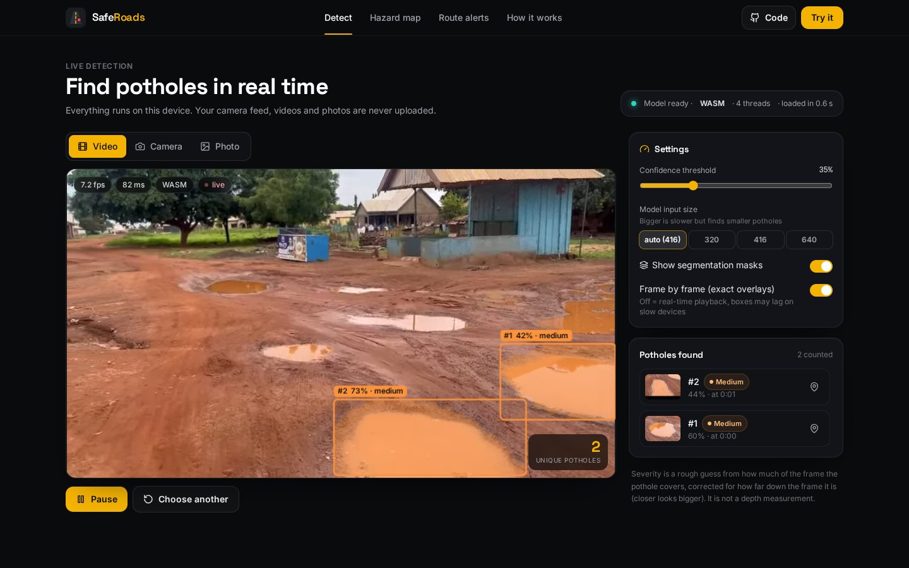
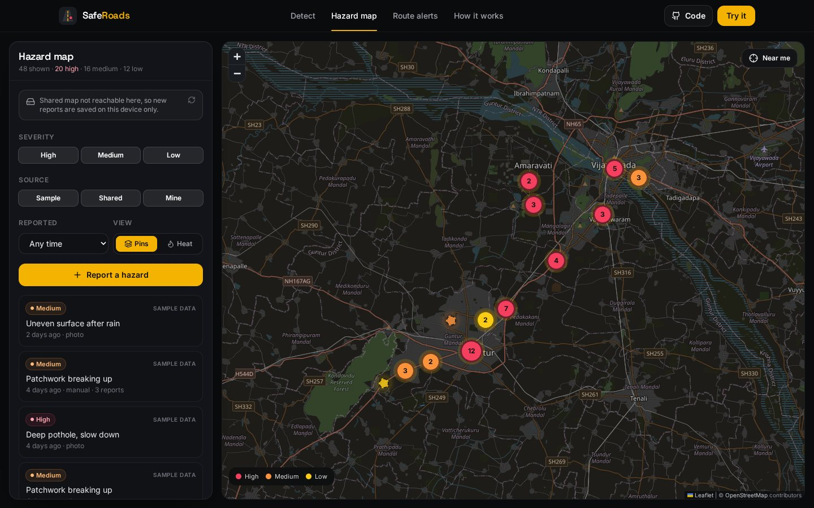
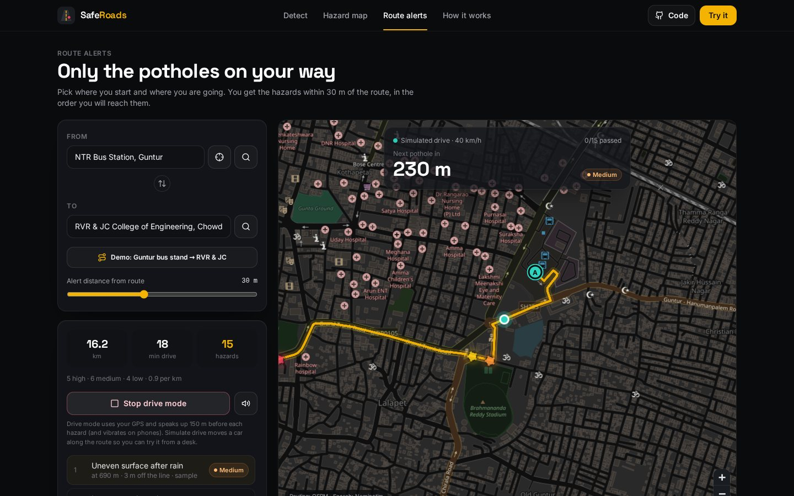
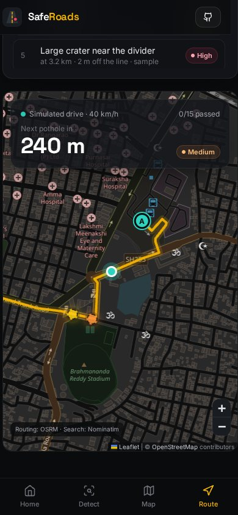

# Safe Roads

Real-time pothole detection that runs in the browser, a shared hazard map, and alerts for the potholes on the route you are about to drive.

**Live:** https://safe-roads-ai.netlify.app &nbsp;·&nbsp; **Code:** https://github.com/Tejdeep-67/safe-roads



This started as a semester project where a Flask server ran a YOLOv8 model on uploaded photos. For this version I moved the detection into the browser (ONNX + WebAssembly/WebGPU in a Web Worker), so it works on a free static host, it is fast enough for live video, and nobody's camera feed gets uploaded anywhere. The Flask backend is still here as an optional local API.

## What it does

**Detect** - point a phone at the road, play a road video, or drop in a photo. The model draws boxes and segmentation masks, shows FPS, and a small IoU tracker counts each pothole once instead of on every frame. There is a confidence slider and a choice of input size (320/416/640).



**Hazard map** - reports go on a Leaflet map with severity colours, clustering or a heatmap, filters and a list. The location comes from the phone's GPS, from the photo's EXIF data, or from a pin you drop. Reports are saved in the browser and, on Netlify, also in a shared store (a Netlify Function + Netlify Blobs) so everyone sees them.



**Route alerts** - search two places (Nominatim), get the route (OSRM), and see only the hazards within 30 m of it, in the order you will reach them. Drive mode follows your GPS and speaks up 150 m before the next pothole (plus vibration on phones). There is a "simulate drive" button so you can try it from a desk.

<p>
  
  
</p>

The map points around Guntur and Vijayawada that are labelled "sample data" are made up (placed on real roads) so the map isn't empty on first visit. They are not real reports.

## How the detection works

1. A frame (camera, video or photo) is turned into an `ImageBitmap` and sent to a Web Worker.
2. The worker letterboxes it to the chosen size and runs `pothole-yolov8n-seg.onnx` with onnxruntime-web. It uses WebGPU when the browser has it, otherwise multi-threaded WASM (threads need cross-origin isolation, which is why `netlify.toml` sets COOP/COEP headers).
3. Boxes above the threshold go through NMS. Each box has 32 mask coefficients that are combined with the prototype masks to get the pothole outline.
4. Severity is a rough rule: how much of the frame the mask covers, corrected for how far down the frame it is (closer things look bigger). It is not a depth measurement.
5. The tracker matches boxes between frames by IoU and centre distance. A pothole is counted after it shows up in 3 frames.

The post-processing, tracker and route maths are plain TypeScript in `src/detection` and `src/geo`, with unit tests.

## Model and results

The weights are a YOLOv8n-seg model (3.26M parameters, one class) fine-tuned on the Kaggle *Pothole Image Segmentation* dataset. I exported it to ONNX (14 MB) and checked it against the PyTorch model: the biggest difference in the raw output was 0.003 and the final boxes were identical on every test image (`model/check_onnx.py`).

The validation mAP saved inside the checkpoint (0.68) is from the training run on its own validation split, so I didn't want to quote that. Instead I tested on a **different public dataset**, the 100-image test split of Roboflow's "Potholes Detection" set (269 potholes), using the same letterbox + NMS as the web app:

| Input size | mAP@50 | mAP@50-95 | Precision @0.35 | Recall @0.35 |
|---|---|---|---|---|
| 640 | 0.341 | 0.158 | 0.676 | 0.279 |
| 416 | 0.363 | 0.172 | 0.717 | 0.264 |
| 320 | 0.340 | 0.156 | 0.724 | 0.234 |

So when it says "pothole" it is right about 2 out of 3 times, but it misses a lot, especially small or far away potholes (recall 0.19 for small ones vs 0.41 for large ones). Ultralytics' own `val` gives 0.333 mAP@50 on the same split for both the `.pt` and the `.onnx`, which matches my script. Details and how to reproduce are in [`model/README.md`](model/README.md).

## Run it locally

You need Node 20+.

```bash
npm ci
npm run dev        # http://localhost:5173
npm test           # vitest + node tests for the Netlify function
npm run build      # type-check + production build into dist/
```

The shared map needs the Netlify Function. Without it the app says so and keeps reports in localStorage. To run the function locally, use `npx netlify dev`, or run the Flask backend below and start Vite with `SAFE_ROADS_API=http://127.0.0.1:5000 npm run dev`.

### Flask backend (optional)

Runs the original PyTorch weights (`backend/models/best.pt`) and keeps reports in SQLite. Python 3.10+.

```bash
cd backend
python -m venv .venv && source .venv/bin/activate
pip install torch==2.15.0 torchvision==0.29.2 --index-url https://download.pytorch.org/whl/cpu   # CPU build, smaller
pip install -r requirements.txt
python app.py      # http://127.0.0.1:5000
pytest             # 20 tests, includes running the model on a demo photo
```

| Endpoint | What it does |
|---|---|
| `GET /api/health` | status and whether the model file is there |
| `POST /api/detect` | multipart `image` (+ optional `conf`, `imgsz`). Returns boxes, scores, severity and the photo's GPS if it has one |
| `GET /api/hazards` | all reports |
| `POST /api/hazards` | `{lat, lng, severity, source, confidence?, note?}`. Same validation, 15 m merging and rate limit as the Netlify Function |

```bash
curl -F image=@public/demo/pothole-2.jpg http://127.0.0.1:5000/api/detect
```

### Model scripts

```bash
cd model
pip install -r requirements.txt
python export_onnx.py                         # best.pt -> public/models/pothole-yolov8n-seg.onnx
python check_onnx.py ../public/demo/*.jpg     # ONNX vs PyTorch
python get_test_data.py && python evaluate.py --model ../public/models/pothole-yolov8n-seg.onnx --data eval_ds --split test
```

## Deploying on Netlify

Everything is in `netlify.toml`: build command `npm run build`, publish directory `dist`, functions in `netlify/functions`. Netlify Blobs works without any setup on Netlify. The headers section turns on cross-origin isolation (needed for multi-threaded WASM) and long caching for the model and assets.

## Project structure

```
src/
  detection/   worker, onnx session, post-processing (decode, NMS, masks), tracker, drawing
  geo/         haversine, point-to-route distance, Nominatim/OSRM calls, drive mode
  hazards/     local + shared store, sample data
  map/         Leaflet setup, cluster/heat layer
  pages/       Home, Detect, HazardMap, RoutePlanner, About
netlify/functions/   hazards API (Netlify Blobs) + tests
backend/       Flask API, SQLite store, detection with best.pt, pytest
model/         ONNX export, ONNX check, evaluation scripts and results
public/        ONNX model, demo photos and video
```

## Limitations

- Recall is low for small or distant potholes, and night or rain footage is a lot worse.
- Severity is a size heuristic, not depth.
- Phone GPS is off by 5-15 m, so pins are approximate.
- The shared store has validation and a per-IP rate limit, but no accounts or moderation.
- Old phones without WebGPU run at a few frames per second.
- Nominatim and the OSRM demo server are free public services with usage limits. Search only runs when you press the button and is limited to one request per second.

Things I want to try next: fine-tuning on Indian road footage, a "confirmed by N people" filter for alerts, and offline caching of the route's hazards.

## Credits

- Demo photos from Wikimedia Commons: [BACHES 1](https://commons.wikimedia.org/wiki/File:BACHES_1.jpg) by Raammm10431 (CC BY-SA 4.0), [Bache mediano](https://commons.wikimedia.org/wiki/File:Bache_mediano.jpg) by Dan crxs (CC BY 4.0), [Otro bache](https://commons.wikimedia.org/wiki/File:Otro_bache.jpg) (CC0).
- Demo video: [Rainwater-Filled Potholes on a Community Road](https://commons.wikimedia.org/wiki/File:Rainwater-Filled_Potholes_on_a_Community_Road.webm) by Knowledge and philosophy (CC BY-SA 4.0), trimmed.
- Test data: [Potholes Detection](https://universe.roboflow.com/project-ssayl/potholes-detection-d4rma) (Roboflow Universe, CC BY 4.0).
- Training data of the model: [Pothole Image Segmentation Dataset](https://www.kaggle.com/datasets/farzadnekouei/pothole-image-segmentation-dataset) (Kaggle).
- Map data © OpenStreetMap contributors. Search by Nominatim, routing by OSRM.
- Built with React, TypeScript, Vite, Tailwind CSS, Leaflet, onnxruntime-web and Ultralytics YOLOv8.
